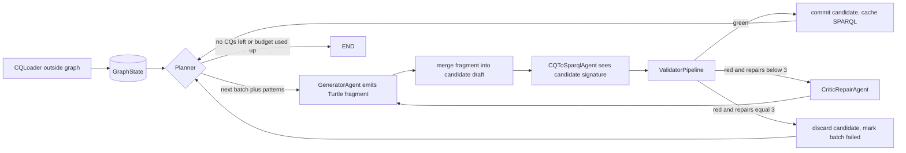

# Ontoagents: repository architecture plan (revised)

> Implementation status and deviations: [ontoagents-scaffold-status.md](ontoagents-scaffold-status.md).

## Context and decisions

- **Task.** Generate an ontology from competency questions (CQs). The baseline is Ontogenia. The data is `data/` (llm4ke: 10 ontologies, 831 CQs).
- **Feedback signal.** Executable validation: rdflib parse, DL consistency, structural CQ coverage, regression on earlier CQs. Not critique by an LLM alone.
- **Leakage rule.** Inside the loop only CQs (and, behind a flag, `description.txt`) are visible. `dm/`, `rq/` and the `rq:` field in `cqs.yml` are used only by evaluation, after the loop.
- **Same inputs for both systems.** `use_description: bool` lives in the experiment config. The system and the baseline always get the same inputs. Default: `false`. Turn it on to match Ontogenia's story-based setup.
- **Loader runs outside the graph.** `GraphState` receives plain `CompetencyQuestion` objects.
- **Agents.**
  - Planner: picks batches and order. Pluggable: `GroupPlanner` (deterministic, uses the CQ `group` field) or `LLMPlanner`.
  - Generator.
  - Critic/Repair.
  - CQ-to-SPARQL Translator.
  - The validator is a deterministic tool, not an agent.
- **What the translator sees.** It sees the draft's **signature**: class and property IRIs, `rdfs:label`, domain/range. It does not see axioms or the generator's reasoning. That is enough to write SPARQL against the real vocabulary, while keeping it independent of how the generator modelled things.
- **Stop conditions.**
  - `max_repair=3` per batch.
  - Global token and iteration budget, enforced in code.
  - Regression check on cached SPARQL from earlier batches.
- **Python 3.14**, package `ontoagents`, pydantic, `ruff` + `ty` + `import-linter` in pre-commit.
- **Current state.** `src/` is empty; the old `semantic_web_and_social_networks/__init__.py` is staged as deleted.

## Dataset quirks the code must handle

| Quirk | Where | Handling |
|---|---|---|
| CQ IDs are the literal `<CQId>` | DOREMUS (check others) | Loader assigns stable IDs `<onto>-<index>` when the ID is missing or a placeholder |
| `rq:` field per CQ | most `cqs.yml` | Dropped by the loader; `CompetencyQuestion` has no field for it; leakage test |
| `[this software]`-style slots | CLaRO set (awo, DemCare, ontodt, stuff, swo) | Kept verbatim in `question`; `has_placeholders` flag for analysis |
| Free-text "In the Wild" CQs | DOREMUS group A | Kept; coverage validator may report `UNTRANSLATABLE`, which counts as neither pass nor fail |
| CQs about specific individuals ("works by Mozart") | DOREMUS, Polifonia, others | Coverage checks only the TBox part (classes/properties used); individuals in the query are allowed to be unknown |
| Empty `dm/` | SILKNOW | Catalog marks `has_reference=False`; reference metrics skip it, CQ-coverage metrics still run |
| Reference split across modules / imports | DemCare (4), Polifonia (15), DOREMUS (+CRM, FRBRoo), `data/shared/time.owl` | `ReferenceOntology` merges every `dm/` file; external imports such as CRM, FRBRoo and Time are tagged as "imported" and reported apart from the ontology's own terms |

## OOP principles

- **Dependency injection.** Depend on abstractions (`Protocol`/`ABC`) and inject through constructors. Agents never construct their own LLM client, validator or pattern repository.
- **Thin graph.** The LangGraph graph is wiring only. All logic lives in classes that can be tested without the graph.
- **Immutable, serializable domain models.** `OntologyDraft` stores **canonical Turtle text** as its source of truth. It parses into a cached `rdflib.Graph` when needed. Methods: `merge(fragment) -> OntologyDraft`, `diff(other) -> OntologyDiff`, `signature() -> Signature`. No live `rdflib.Graph` ever goes into `GraphState`, so checkpointing works.
- **`GraphState`** is a `TypedDict` with reducers. It holds all counters (iterations, repair count, tokens used). `BudgetPolicy` is a stateless object holding the limits, and routing functions are pure: `(state, policy) -> next_node`.
- **One interface for system and baseline.** `OntologyGenerator.generate(inputs: GenerationInputs) -> GenerationResult`, where the result holds the draft plus a trace. It is defined in `domain/` so that `evaluation` really depends only on `domain`.
- **The composition root is `cli.py`.** It is the only place that wires concrete classes together.

## Target layout

```
src/ontoagents/
  domain/        competency_question.py, ontology.py (OntologyDraft, Signature, OntologyDiff),
                 report.py, pattern.py, generator.py (OntologyGenerator Protocol, GenerationInputs/Result)
  data/          loader.py (CQLoader ABC, YamlCQLoader), catalog.py (reads data/dm-rdf.yml),
                 reference.py (ReferenceOntology: multi-file merge, import tagging)
  llm/           client.py (LLMClient Protocol), langchain_client.py, fake.py (FakeLLMClient)
  agents/        base.py, planner.py (GroupPlanner, LLMPlanner), generator.py, critic.py,
                 cq_translator.py, prompts/ (jinja2)
  validation/    base.py, syntax.py, consistency.py, cq_coverage.py, regression.py, pipeline.py
  patterns/      repository.py (PatternRepository ABC, StaticPatternRepository)
  graph/         state.py, routing.py, budget.py (BudgetPolicy), builder.py, system.py (AgentSystem implements OntologyGenerator)
  evaluation/    alignment.py, metrics.py (Metric ABC), runner.py (ExperimentRunner)
  baselines/     ontogenia.py (OntogeniaBaseline implements OntologyGenerator)
  config.py      cli.py
tests/{unit,integration}/
experiments/     YAML run configs (seed, temperature, model, use_description, ablation flags) and results/
```

`data/reference.py` is used only by `evaluation` and `cli`. An import-linter contract enforces this.

## Validation pipeline (cheapest first, stops at the first failure)

1. **SyntaxValidator.** rdflib parses the Turtle. It also checks that every IRI is under the run's base namespace or a whitelisted vocabulary (owl, rdfs, xsd, skos, plus ODP namespaces).
2. **ConsistencyValidator.** owlready2 + HermiT. It checks that the ontology is consistent and that no named class is unsatisfiable. HermiT needs a Java runtime, which is documented in the README. Tests that need Java are marked `@pytest.mark.reasoner` and skipped when `java` is missing. `owlrl` is not used, because an OWL-RL closure is not a DL consistency check.
3. **CQCoverageValidator.** Input: the translator's SPARQL for the current batch. It parses each query with rdflib's SPARQL parser and checks each triple pattern structurally:
   - every class or property IRI exists in the draft's signature;
   - when domain/range are declared, they are compatible with the variable types in the query (inferred from `rdf:type` patterns);
   - **when domain/range are missing, it reports a warning, not a failure**, which keeps it from punishing under-specified but valid drafts;
   - unknown individuals are allowed.

   Queries are not executed, because a TBox has no data. The translator may output `UNTRANSLATABLE`. That is counted separately and is not sent to repair.
4. **RegressionValidator.** Re-runs check 3 on the **cached** SPARQL of every CQ from earlier green batches against the new draft. If an IRI was renamed or removed, the old query breaks and the check fails.

## Graph flow



Rules:
- **The Generator emits an incremental Turtle fragment,** not the whole ontology. Its context is the current draft's signature plus the batch. The fragment is merged into a **candidate** draft. The committed draft changes only on green.
- **The Translator runs once per generation attempt,** and only for the current batch. Earlier batches reuse cached SPARQL through the regression check.
- **A regression failure counts as a red result for the current batch.** The Critic receives the broken earlier CQs in its report, and the same repair budget applies.
- **A failed batch rolls back to the last committed draft,** so a broken candidate never spoils later batches. Failed CQs are recorded in the trace and may be retried once at the end if budget remains (config flag).
- **Every node increments its counters in `GraphState`.** Routing checks `BudgetPolicy` before each LLM node.

## Dependency direction (enforced by import-linter, including transitive imports)

Layers contract, top to bottom: `cli` → `evaluation | baselines | graph` → `agents | validation` → `llm | patterns | data` → `domain`.
Extra forbidden contracts:
- `agents`, `graph`, `validation`, `llm`, `patterns` must not import `ontoagents.evaluation`, `ontoagents.baselines` or `ontoagents.data.reference`.
- `baselines` must not import `ontoagents.evaluation`.

## Evaluation

Generated IRIs will never match the reference, so every comparison with the reference goes through **alignment**.

- **`Aligner` (Strategy):**
  - `LexicalAligner`: normalised local name and `rdfs:label`, splitting camelCase and snake_case, lowercasing, lemmatising, then string similarity with a threshold.
  - `EmbeddingAligner`: optional, added later.
  - Each produces one-to-one matches between the generated terms and the reference terms (Hungarian assignment over similarity).
- **Metrics (each a `Metric`):**
  - Class precision/recall/F1 and property precision/recall/F1 after alignment. Own terms and imported terms are reported separately.
  - Structural agreement: share of aligned subclass edges, and of domain/range pairs, that also hold in the reference.
  - Internal CQ coverage: pass/warn/fail/untranslatable rates from the validator, available for every ontology including SILKNOW.
  - Cost: tokens, LLM calls, wall time.
- **Reference SPARQL (`rq/`)** is rewritten through the alignment (reference IRIs replaced with aligned generated IRIs) and then run through the structural check. The score is the share of queries that are structurally valid after rewriting. This is a secondary metric, because it depends on the quality of the alignment.
- **LLM-as-judge** is out of scope for the scaffold and is listed under open items.
- **`ExperimentRunner`** takes an `OntologyGenerator`, a catalog selection and a list of metrics. It writes one results JSON per run with the full config (seed, temperature, model, flags) and the generation trace.

## Tooling

- **`pyproject.toml`:**
  - `name = "ontoagents"`;
  - `[tool.uv.build-backend] module-name = "ontoagents"`;
  - `[project.scripts] ontoagents = "ontoagents.cli:main"`;
  - move `pandas` and `matplotlib` to a `notebooks` dependency group.
- **Runtime deps:** `langgraph`, `langchain-core`, `pydantic`, `pydantic-settings`, `jinja2`, `owlready2`, `rapidfuzz` (lexical alignment), `scipy` (assignment), plus a provider package when it is chosen. `rdflib` and `pyyaml` are already present.
- **Dev deps:** `pytest`, `ruff`, `ty`, `pre-commit`, `import-linter`.
- **Ruff:**
  - rules `E,F,I,UP,B,TID,ANN`;
  - `D` only for `src/ontoagents/domain/**` and the public Protocols/ABCs;
  - `ANN` ignored in `tests/**`;
  - `ban-relative-imports = "all"`.
- **`.pre-commit-config.yaml`:** `ruff check --fix`, `ruff format`, local hook `uv run ty check`, local hook `uv run lint-imports`. Targeted `# ty: ignore[...]` comments are allowed only in `graph/builder.py`.

## Implementation order (vertical slice first)

1. **Tooling and skeleton.** pyproject, pre-commit, ruff, import-linter contracts, empty package.
2. **`domain/`.** Models, including `OntologyDraft` as Turtle text and the `OntologyGenerator` Protocol, with tests.
3. **`data/`.** Loader with ID generation and dropping of the `rq` field, catalog, `ReferenceOntology`. Tests: no `rq` leaks into `CompetencyQuestion`, stable IDs, multi-file merge, SILKNOW marked as having no reference.
4. **`llm/`.** Protocol, LangChain adapter, `FakeLLMClient`.
5. **Baseline slice.**
   - `OntogeniaBaseline`;
   - `LexicalAligner` plus the class/property F1 metrics;
   - `ExperimentRunner`;
   - `ontoagents run --system baseline --ontology awo`.

   **Checkpoint:** first real baseline numbers on awo (or stuff), recorded in `experiments/results/`.
6. **`validation/`.** Syntax, then consistency (HermiT), then CQ coverage, then regression, then the pipeline. Unit tests use small hand-written Turtle fixtures.
7. **Agents and graph.**
   - Generator first, with `GroupPlanner` and no Critic. Run it end to end against the baseline.
   - Then the translator and coverage feedback, then the Critic, then `LLMPlanner`.
   - Each addition is a config flag, so it can be switched off in ablations.
8. **Integration test with a fake LLM.** Repair limit reached, rollback on a failed batch, a regression failure triggering repair, budget stop, and a SPARQL cache hit for earlier batches.
9. **Ablations and the full run.** All 9 ontologies with a reference, plus SILKNOW (coverage metrics only), each in these configs: baseline, full system, no Critic, group vs. LLM Planner, no regression check.

## Open items (not blocking the scaffold)

- **LLM provider.** The scaffold stays provider-agnostic behind `LLMClient`.
- **Ontogenia reproduction details.** Prompt, how ODPs are included, whether the story or description is used. These set the default for `use_description`.
- **Alignment threshold.** Calibrate it on one ontology by inspecting matches by hand; then report a sensitivity curve.
- **`EmbeddingAligner` and LLM-as-judge** as secondary metrics.
- **ODP source.** A static catalog first, retrieval later.
- **Java runtime in CI,** for HermiT.
